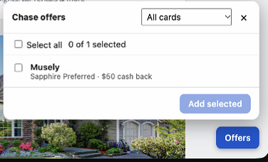

# Offer Adder (local)

A small Chrome extension that lists unadded card offers on **Amex, Chase and Citi**
and adds the ones you select, in one go. Personal tool, not published to the Web Store.

## Install

1. Open `chrome://extensions` and turn on **Developer mode** (top right).
2. Click **Load unpacked** and choose this folder.
3. Keep the folder where it is. Chrome reads it from there.

After editing any file, click the reload icon on the extension's card in
`chrome://extensions`, then reload the bank page.

## How to use

1. Sign in to your issuer and open a page on its site (the offers page works best):
   - Amex: `global.americanexpress.com` (visit the Offers page once so your card list loads)
   - Chase: your account dashboard on `chase.com`
   - Citi: `online.citi.com` (the dashboard or the merchant offers page)
2. Click the blue **Offers** button at the bottom right of the page.
3. Pick a card from the dropdown, or leave it on **All cards** to see every card's offers in one list.
   Each row shows the merchant, the card name and the offer.
4. Tick the offers you want, or tick **Select all**. The counter shows how many are selected.
5. Click **Add selected**. Each row shows *added* or *failed* as it goes.
6. Click **Stop** (the same button) at any time to halt.
7. Click the **×** to close the panel.

### Export offers you've already added

Click **Copy added** in the panel footer to copy every offer already on the selected card (or all cards) to the clipboard, ready to paste into Claude or a notes file. Each entry has the cards, vendor, offer, expiry date and full terms; identical offers across cards are merged into one entry.

Tested on Chase. Amex and Citi use the same button, but field names for expiry and terms are matched loosely and may come out as `unknown`. If the browser blocks the clipboard (for example, DevTools has focus), a text box appears with the text selected so you can press Cmd+C.

Start with a card or two and a few offers, then check them on the bank's site before running the whole list.

### What to expect

- Adds are paced to avoid rate limits. If the issuer returns a 429, the extension waits and retries that offer once.
- It stops by itself after 3 failures in a row.
- An Amex offer that is already on another card counts as added.
- If a row shows an ID instead of a merchant name, open DevTools (Cmd+Option+J) and look for
  `[offer-adder]` lines in the console. They help when an issuer changes its response format.

## Privacy

- Runs only on `global.americanexpress.com`, `*.chase.com` and `online.citi.com`.
- Requests no extension permissions and stores nothing.
- Makes requests only to the issuers' own endpoints, using your existing logged-in session.
  Nothing is sent anywhere else, and there is no account or server of its own.
- The whole thing is two small files, `manifest.json` and `content.js`, so you can read all of it.

## Caveats

- It uses the issuers' internal APIs, which are undocumented and can change without notice.
- Automating your account may be restricted by an issuer's terms of service.
